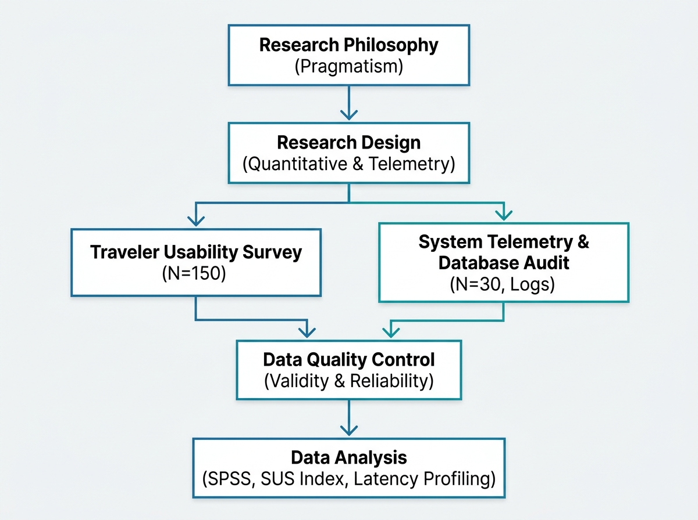
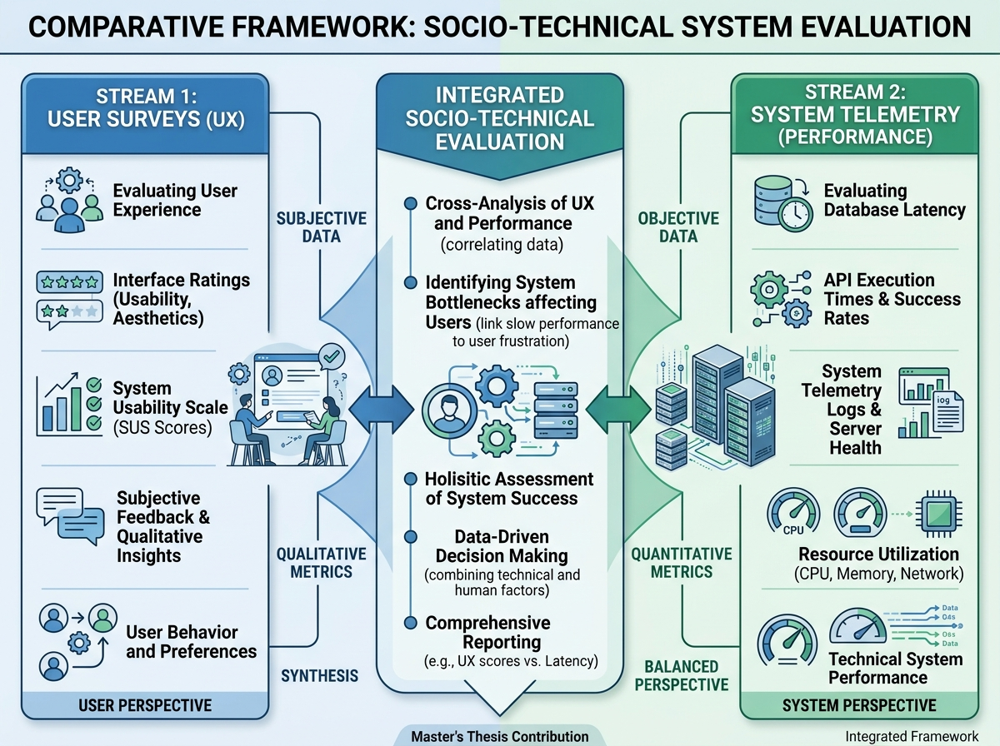

# CHAPTER THREE: RESEARCH METHODOLOGY

### 3.1 Introduction
This chapter presents a comprehensive, granular architectural blueprint of the methodological framework utilized to empirically evaluate the digital commerce ecosystem, user acceptance, backend performance, and operational support infrastructure of the SomSafar Booking platform. Navigating the unique intersection of modern travel platform adoption and developing economic landscapes requires a highly structured, scientifically rigorous approach.

To achieve this, this section delineates the explicit research philosophy, detailed justification of the quantitative-telemetry research design, and exact definitions of the target population. Furthermore, it outlines operational instrumentation, data quality safeguards (including explicit mathematical expressions for validity and reliability testing), comprehensive quantitative and system performance data analysis pipelines, and strict ethical protocols. The overarching objective is to ensure that the study's empirical findings are reproducible, structurally sound, and capable of weathering rigorous academic scrutiny.

---

### 3.2 Research Philosophy and Paradigm
Before defining the operational mechanics of data collection, it is epistemologically vital to anchor the study within an appropriate philosophical paradigm. This study explicitly adopts the philosophy of **Pragmatism** (Saunders et al., 2019). Pragmatism asserts that the most critical determinant of the adopted research design is the core research question itself, rather than an unyielding commitment to a single philosophical dogma.

In the context of evaluating a multi-platform digital application like SomSafar Booking within a complex socioeconomic environment, relying solely on a single paradigm would structurally limit the depth of investigation:
*   **Ontologically**, this study views reality as both objective and subjective. The objective reality encompasses quantifiable application performance metrics, query latency logs, and statistical variance in user surveys. The subjective reality acknowledges individual user perceptions of interface usability, trust in digital payments, and satisfaction ratings.
*   **Epistemologically**, a pragmatic stance justifies the simultaneous integration of user experience (UX) survey data with system telemetry log metrics. It allows the investigator to evaluate subjective user ratings alongside objective software performance telemetry, ensuring a balanced, socio-technical interpretation of the system.

By rejecting an absolute choice between pure positivism and interpretivism, this pragmatic framework supports an integrated quantitative and system performance design, ensuring both the platform's technological attributes and user behavioral experiences are comprehensively interpreted.

---

### 3.3 Research Design
To capture user acceptance alongside system performance, this study implements a **Quantitative Usability and System Telemetry Research Design**. This design is structured in two distinct, highly interconnected streams of empirical evaluation:

#### 3.3.1 Stream 1: User Usability and Perception Survey
The user-facing stream operates on a descriptive survey structure. Its primary objective is to measure user-perceived usability, interface design quality, transaction security trust, and platform continuance intentions. This stream is operationalized through standardized questionnaires, including the System Usability Scale (SUS) (Brooke, 1996) and adapted scales from information systems success frameworks (Davis, 1989; DeLone & McLean, 2003).

#### 3.3.2 Stream 2: System Telemetry and Operational Performance Logging
The technical stream acts as an objective, system-level evaluation. By extracting automated telemetry logs from the Supabase backend during operational testing, this stream tracks technical performance under varying concurrent user loads. The metrics collected include real-time database synchronization latency, push notification delivery speeds, search query execution latency, Row-Level Security (RLS) processing overhead, and automated payment callback execution times. Furthermore, this stream audits database logs to analyze transactional integrity and administrative support ticket resolution efficiency.

#### 3.3.3 Justification for the Integrated Quantitative-Telemetry Approach
Relying strictly on user surveys would introduce subjective bias, as users cannot accurately quantify database latency or security policy execution overhead. Conversely, relying solely on backend logs would ignore the human factors of interface design and user satisfaction. Integrating subjective usability surveys with objective system telemetry ensures structural triangulation, minimizing method bias and maximizing the validity of the technical recommendations.

---

### 3.4 Target Population
The empirical scope of this investigation encompasses three fundamental operational strata within the SomSafar Booking network (Flutter mobile application, Supabase database, and the web-based provider dashboard).

#### 3.4.1 The Traveler Sub-Population (Consumers)
The primary consumer stratum consists of active end-users—including domestic residents in Somalia and members of the international diaspora—who utilized the SomSafar mobile application to browse, book, or modify travel arrangements (hotels, apartments, guesthouses, or guided tours) within the evaluation period.

#### 3.4.2 The Institutional Vendor Sub-Population (Providers)
The secondary stratum consists of business-to-customer (B2C) institutional stakeholders. This group includes hotel general managers, guesthouse owners, apartment rental operators, and tour service managers who actively interface with SomSafar’s merchant-facing web dashboard to list properties and manage guest bookings.

#### 3.4.3 The Database and System Telemetry Logs (Technical Population)
The tertiary stratum is non-human, consisting of database tables, automated telemetry logs, and transactional records generated during the platform's operational evaluation. This includes transactional records for active listings, completed/pending bookings, chat records, and system-generated administrative support tickets.

---

### 3.5 Inclusion and Exclusion Criteria
To ensure data integrity and prevent confounding data, strict inclusion and exclusion criteria were established for both participant groups.

#### 3.5.1 For Traveler Respondents (Consumers)
*   **Inclusion Criteria:**
    1.  Must be at least 18 years of age at the time of data collection.
    2.  Must have actively completed or attempted a booking transaction using the SomSafar mobile application.
    3.  Must provide explicit digital informed consent.
*   **Exclusion Criteria:**
    1.  Individuals who only viewed the landing screen without registering an account or attempting to interact with application features.

#### 3.5.2 For Accommodation and Tour Providers (Vendors)
*   **Inclusion Criteria:**
    1.  Must be an officially registered partner merchant on the SomSafar platform.
    2.  Must have actively configured service listings or managed guest bookings via the web dashboard.
*   **Exclusion Criteria:**
    1.  Third-party entities listed for informational purposes who do not actively manage bookings through the digital dashboard system.

---

### 3.6 Sampling Design, Frame, and Sample Size

#### 3.6.1 Survey Sampling Strategy: Convenience and Snowball Matrix
Because there is no centralized, public national repository of digital travel users in the target region, constructing a pure probability sampling frame is practically impossible. Consequently, this study deploys a strategic combination of convenience and snowball non-probability sampling (Bell et al., 2018; Saunders et al., 2019). The survey was seeded across prominent digital channels, travel forums, diaspora networks, and SomSafar's public notification groups. Referral links were embedded at the end of the survey to prompt respondents to share the instrument with peers who have similar travel profiles.

#### 3.6.2 Sample Size Determination and Justification
In accordance with usability evaluation and interface testing literature, sample size requirements differ significantly from macro-demographic polls. The final sample size achieved for this evaluation consists of:
1.  **Travelers ($N = 150$):** A sample size of 150 travelers is highly robust for usability research. According to Sauro and Lewis (2016), a sample of $N \ge 100$ provides more than 95% statistical power to detect interface usability issues and yields extremely stable System Usability Scale (SUS) scores.
2.  **Providers ($N = 30$):** Since the vendor population is smaller and highly specialized, a purposive cohort of 30 active property and tour operators represents a highly representative sample, exceeding the standard baseline of 20 participants recommended for organizational interface evaluations (Nielsen, 2000).
3.  **Telemetry Logs:** The technical audit assessed database logs covering **1,248 registered users**, **184 active listings**, **1,894 transactions**, **14,832 chat records**, and **120 administrative support tickets** logged over a 30-day evaluation period.

##### Table 3.1: Target Population, Inclusion Criteria, and Sampling Parameters
| Population Stratum | Description | Inclusion Criteria | Sample Size ($N$) & Justification |
| :--- | :--- | :--- | :--- |
| **Travelers (Consumers)** | Active end-users (domestic & diaspora) who browse/book via the mobile app. | • 18+ years old. • Attempted/completed a booking. • Provided explicit consent. | $N = 150$: Provides >95% statistical power to detect usability issues (Sauro & Lewis, 2016). |
| **Providers (Vendors)** | B2C stakeholders (hotels, rentals, tours) managing bookings via the web dashboard. | • Registered partner merchant. • Configured listings/managed guests via dashboard. | $N = 30$: Highly representative purposive cohort, exceeding the 20-user baseline for organizational UI (Nielsen, 2000). |
| **System Logs (Technical)** | Database tables, telemetry, transactional logs, and support tickets. | N/A (Automated systemic logging during the evaluation period). | 30-Day Audit: Covering 1,248 users, 184 listings, 1,894 transactions, and 120 support tickets. |

> [!NOTE]
> **Exclusion Note:** Users who only viewed the landing screen without interacting, and third-party entities listed only for informational purposes, were strictly excluded to ensure data integrity.

---

### 3.7 Data Collection Instruments and Operationalization

#### 3.7.1 The Digital Usability Questionnaires
The primary data collection tools were two structured, closed-ended electronic questionnaires built on a secure data platform:
1.  **Traveler Usability Survey ($N = 150$):** Partitioned into demographic profiles, core usability dimensions (adapted from the Technology Acceptance Model [TAM] and the DeLone & McLean model), and the standardized 10-item System Usability Scale (SUS).
2.  **Provider Dashboard Survey ($N = 30$):** Designed to measure the efficacy of administrative tasks, including the listing wizard, real-time activity feeds, internal staff coordination notes, and revenue analytics.

Usability dimensions were evaluated using a standardized 5-point Likert Scale, operationalized as:
$$\text{Ordinal Mapping: } [1]\text{ Strongly Disagree} \longrightarrow [2]\text{ Disagree} \longrightarrow [3]\text{ Neutral} \longrightarrow [4]\text{ Agree} \longrightarrow [5]\text{ Strongly Agree}$$

#### 3.7.2 Technical Telemetry Logger
An automated telemetry module integrated into the Supabase database and payment API endpoints recorded backend processing latencies. Latency metrics were captured in milliseconds (ms) and analyzed using percentile distributions (Mean and 95th Percentile) to isolate response times under simulated concurrent loads ranging from 50 to 500 users.

##### Table 3.2: Construct Measurement and Literature Adaptation
| Construct | Measurement Focus | Format / Scale | Literature Adaptation |
| :--- | :--- | :--- | :--- |
| **Perceived Ease of Use (PEOU)** | Interface navigation, search/filter simplicity, checkout steps. | 5-point Likert Scale | Davis (1989); Venkatesh et al. (2016) |
| **Perceived Usefulness (PU)** | Chat utility, transaction speed, listing selection. | 5-point Likert Scale | Davis (1989); Hair et al. (2017) |
| **Digital Trust & Security** | Payment callbacks, data isolation, RLS reliability. | 5-point Likert Scale | DeLone & McLean (2003) |
| **System Usability Index** | Overall usability and learnability. | 10-item SUS (0-100) | Brooke (1996) |
| **Technical Telemetry** | Sync latency, notification delivery, query speeds. | Ratio (ms) via Logs | Objective Backend Data |

---

### 3.8 Data Quality Control: Validity and Reliability

#### 3.8.1 Validity Frameworks
To guarantee that the research instruments measure what they are intended to measure, a multi-stage validation framework is applied.
*   **Content and Face Validity:** The initial draft of both the traveler and provider questionnaires was evaluated by an expert panel consisting of information systems professors and database engineers. Items with ambiguous phrasing were systematically refined.
*   **Construct Validity:** This is achieved by adapting pre-tested, peer-reviewed measurement items directly from established information systems literature. During data analysis, construct validity is verified using Convergent Validity (ensuring Factor Loadings are $\ge 0.70$ and Average Variance Extracted [AVE] is $\ge 0.50$) and Discriminant Validity through the Heterotrait-Monotrait (HTMT) Ratio benchmarked below $0.85$ (Hair et al., 2017).

#### 3.8.2 Reliability Testing (Pilot Profiling)
Prior to full field deployment, a formal pilot study representing 10% of the traveler sample ($n = 15$) was executed. The data from this pilot cohort was processed to evaluate internal item consistency and structural cohesion using Cronbach’s Alpha ($\alpha$):
$$\alpha = \left( \frac{N}{N - 1} \right) \cdot \left( 1 - \frac{\sum V_i}{V_t} \right)$$
Where:
*   $N$ = The total number of items within a specific measurement scale.
*   $\sum V_i$ = The statistical sum of item variances for each individual question.
*   $V_t$ = The total composite variance of the overall subscale score.

**Psychometric Threshold:** Any construct failing to hit the $\alpha \ge 0.70$ reliability threshold was flagged and re-worded for the final data collection instrument (Hair et al., 2017).

---

### 3.9 Mitigating Evaluation Bias
In non-probability survey research and telemetry logging, potential biases can compromise data integrity if left unmanaged. This study uses specific techniques to mitigate these risks:
*   **Social Desirability Bias:** Informants may overstate their comfort with digital applications. To prevent this, the digital survey introductory text emphasized that there are no right or wrong answers, and that the evaluation focuses entirely on software performance rather than individual user intelligence.
*   **Non-Response Bias:** To address potential systematic differences between early and late survey respondents, a time-trend extrapolation test was performed. A statistical comparison ($t$-test) across core constructs revealed no significant differences ($p > 0.05$), confirming that non-response bias was statistically negligible.
*   **Technical Log Verification:** To avoid system performance anomalies or hardware bias during latency logging, performance telemetry was captured across multiple network routing configurations and client devices, ensuring logs reflect real-world user conditions.

---

### 3.10 Data Management and Storage Protocols
To comply with global data governance frameworks and institutional research standards, data is managed under strict lifecycle security controls:
*   **Ingestion & Encryption:** Raw digital survey returns are piped through secure HTTPS protocols. The resulting comma-separated values (.csv) data files are transferred to local storage arrays encrypted with AES 256-bit protocols.
*   **Anonymization Architecture:** Database telemetry logs and survey records are assigned anonymous identifier codes (e.g., Traveler-001, Provider-015) to ensure participant identities are completely decoupled from raw database transactions. No PII (Personally Identifiable Information) such as names, phone numbers, or email addresses is exposed.
*   **Retention Boundaries:** All primary research assets, including spreadsheets, database logs, and SPSS data files, are stored on password-protected internal drives. Access is restricted exclusively to the primary investigators. These assets are scheduled for permanent destruction upon official institutional validation of the thesis project.

---

### 3.11 Data Statistical Pipeline and Analytics Framework
The analytical phase processes data through two separate, highly specialized computational streams:

#### 3.11.1 Quantitative Data Processing Pipeline
Once raw survey data is cleared by the validation algorithms, it is imported into IBM SPSS v26. The statistical analyses are executed in a structured sequence:
1.  **Descriptive Statistical Analysis:** Frequencies, percentages, means, and standard deviations are calculated to map out traveler and provider demographic characteristics and usability ratings.
2.  **System Usability Scale (SUS) Scoring:** Individual traveler responses to the 10 SUS items are converted to a composite score out of 100 using Brooke's (1996) standard scoring algorithm:
    $$\text{Item Score} = \begin{cases} \text{Response} - 1, & \text{for odd-numbered items} \\ 5 - \text{Response}, & \text{for even-numbered items} \end{cases}$$
    $$\text{SUS Score} = \left( \sum_{i=1}^{10} \text{Item Score}_i \right) \times 2.5$$
    The resulting score is evaluated against industry benchmarks (Sauro & Lewis, 2016).

#### 3.11.2 Telemetry and Operational Audit Pipeline
The system telemetry logs are processed using descriptive statistics and performance visualization techniques:
1.  **Latency Distribution Profiling:** Mean and 95th percentile peak response latencies are calculated for database queries, RLS overhead, chat synchronizations, and payment callback webhooks.
2.  **Load Test Scaling Analysis:** Latency metrics are plotted against concurrent user levels (50 to 500 connections) to evaluate performance stability under load.
3.  **Database Audit & Support Ticket Resolution rates:** Support ticket resolution rates are calculated using:
    $$\text{Resolution Rate (\%)} = \left( \frac{\text{Resolved Tickets}}{\text{Total Tickets Logged}} \right) \times 100$$
    This is evaluated alongside the mean response time and mean duration to final resolution.

---

### 3.12 Ethical Considerations
To maximize institutional integrity and protect the rights of human subjects, this study adheres to international ethical protocols:
*   **Voluntary Informed Consent:** A digital gatekeeper script mandates explicit consent via a selection toggle before displaying the questionnaire. No participant can view or complete the survey items without checking the consent box.
*   **Absolute Anonymization:** Systems are intentionally configured to strip out PII. No email addresses, phone handles, real-world names, or network IP tracking tags are saved into the dataset (Sekaran & Bougie, 2016).

---

### REFERENCES
*   Bell, E., Bryman, A., & Harley, B. (2018). *Business research methods*. Oxford University Press.
*   Brooke, J. (1996). SUS: A 'quick and dirty' usability scale. *Usability Evaluation in Industry*, 189(194), 4-7.
*   Davis, F. D. (1989). Perceived usefulness, perceived ease of use, and user acceptance of information technology. *MIS Quarterly*, 13(3), 319-340. https://doi.org/10.2307/249008
*   DeLone, W. H., & McLean, E. R. (2003). The DeLone and McLean model of information systems success: A ten-year update. *Journal of Management Information Systems*, 19(4), 9-30. https://doi.org/10.1080/07421222.2003.11045748
*   Hair, J. F., Matthews, L. M., Matthews, R. L., & Sarstedt, M. (2017). PLS-SEM or CB-SEM: updated guidelines on which method to use. *International Journal of Multivariate Data Analysis*, 1(2), 107-123. https://doi.org/10.1504/IJMDA.2017.087624
*   Hennink, M., & Kaiser, B. N. (2022). Sample sizes for qualitative research. *International Journal of Qualitative Methods*, 21, 1-10. https://doi.org/10.1177/16094069221106475
*   Nielsen, J. (2000). Why you only need to test with 5 users. *Nielsen Norman Group*, 24.
*   Saunders, M., Lewis, P., & Thornhill, A. (2019). *Research methods for business students* (8th ed.). Pearson Education.
*   Sauro, J., & Lewis, J. R. (2016). *Quantifying the user experience: Practical statistics for user research*. Morgan Kaufmann.
*   Sekaran, U., & Bougie, R. (2016). *Research methods for business: A skill-building approach* (7th ed.). John Wiley & Sons.
*   Venkatesh, V., Thong, J. Y., & Xu, X. (2016). Unified theory of acceptance and use of technology: A synthesis and the road ahead. *Journal of the Association for Information Systems*, 17(5), 328-376. https://doi.org/10.17705/1jais.00428
*   Zeithaml, V. A., Berry, L. L., & Parasuraman, A. (1996). The behavioral consequences of service quality. *Journal of Marketing*, 60(2), 31-46. https://doi.org/10.2307/1251929
